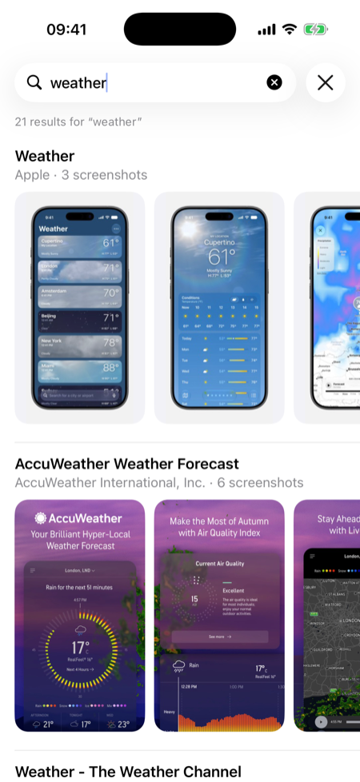
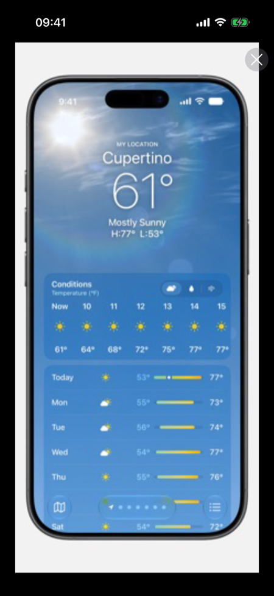
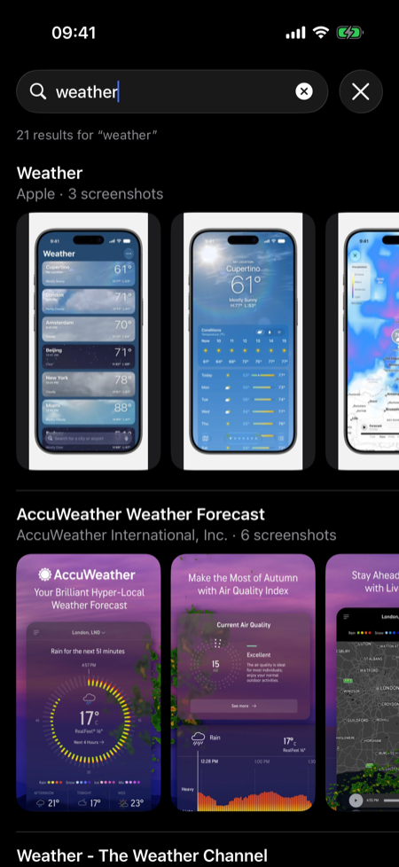
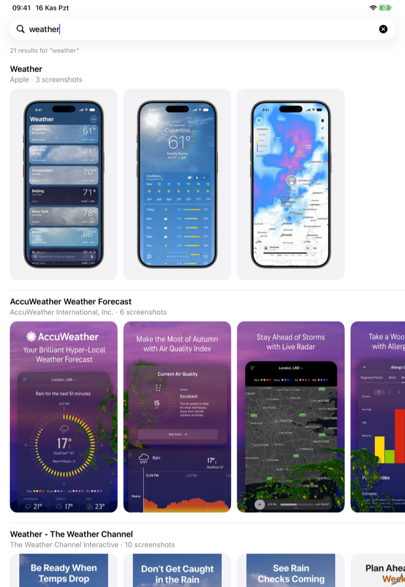

# AppGallery

[Türkçe](#turkce) · [English](#english)

<a id="turkce"></a>
## Türkçe

AppGallery, iTunes Search API üzerinden uygulama arayıp ekran görüntülerini yatay galerilerde gösteren bir iOS projesi. Bir görsele dokununca tam ekran önizlemesi açılıyor. Bu case çalışmasında arama değişikliklerini doğru yönetmeye, aynı anda en fazla üç görsel indirmeye ve bu davranışları test edebilmeye odaklandım.

### Ekran görüntüleri

| Arama sonuçları | Önizleme | Karanlık mod |
|:---:|:---:|:---:|
|  |  |  |

iPad'de aynı ekran, genişliğe göre daha fazla ekran görüntüsü gösteriyor:



### Çalıştırma

- Xcode 26 veya üzeri (`@concurrent` için Swift 6.2 gerekiyor)
- Minimum iOS 16.0; iPhone ve iPad için genişliğe göre uyarlanan arayüz
- Tek üçüncü parti bağımlılık: SnapKit 5.7.1

`AppGallery.xcodeproj` dosyasını açıp `AppGallery` scheme'ini ve bir simülatör seçin. Xcode, SnapKit'i çözümler. Uygulamayı `⌘R`, testleri `⌘U` ile çalıştırabilirsiniz.

```bash
xcodebuild -project AppGallery.xcodeproj -scheme AppGallery \
  -destination 'platform=iOS Simulator,name=iPhone 17' test
```

Gerekirse cihaz adını kurulu bir simülatörle değiştirin.

### Teknik tercihler

#### Arama

Her tuşta istek göndermek yerine 350 ms debounce kullandım. Metnin başındaki ve sonundaki boşlukları temizliyorum; iki karakterden kısa sorgularda istek göndermeden başlangıç durumuna dönüyorum. Aynı sorguyu tekrar göndermiyorum, hata ekranındaki Retry ise son aramayı yeniden başlatıyor. Debounce gereksiz istekleri azaltıyor; tek başına bir rate limiter değil.

Sorgu değiştiğinde önceki aramayı ve görsel indirmelerini iptal ediyorum. Geçerli yeni sorgu için yüklenme durumu hemen gösteriliyor. `Task.cancel()` işin anında duracağını garanti etmediği için bir generation değeri de tutuyorum: geç dönen eski yanıtın değeri güncel değilse sonucu kullanmıyorum.

İstekleri `URLComponents` ile oluşturuyorum. `media=software` ile uygulamaları, `country=tr` ile Türkiye mağazasını seçtim; kapsamı `limit=25` ile sınırladım. Ağ katmanında `URLSession` kullandım; bu proje için ek bir ağ kütüphanesine ihtiyaç duymadım.

#### Görsel indirme ve önbellek

Görev bütün `screenshotUrls` görsellerinin indirilmesini istediği için sonuçlar gelince hepsini kuyruğa alıyorum. Liste ve önizleme aynı `ImageDownloadManager` nesnesini kullanıyor; üç indirme sınırı ikisi için ortak.

Üçlü sınırı, `pending` kuyruğu ve dolu slotları tutan `occupiedSlots` sayacıyla yönettim. Boş slot varsa sıradaki URL başlatılıyor; kapasite kontrolü ile slot ayırma arasında `await` yok. Bir indirme başarı, hata veya iptalle döndüğünde slotunu bırakıyor ve `startNextDownloads()` sıradaki işleri başlatıyor. `DispatchSemaphore` da uygun bir tasarımda kullanılabilir; ancak `wait()` çağrısı thread'i bloke edebilir. Burada boş slot için thread bekletmeden iş başlatan yaklaşım, async/await akışına daha uygun geldi.

İptal edilen işin slotunu hemen boşaltmıyorum; iş gerçekten döndüğünde bırakıyorum. Böylece eski istekler kapanırken yenilerinin başlayıp üçlü sınırı aşmasını önlüyorum. Kuyrukta bekleyen bir görsel önizlemede açılırsa öne alınıyor; önbellekteyse veya zaten indiriliyorsa yeni iş başlamıyor. Başarısız indirmeler kullanıcı isteğiyle tekrar deneniyor.

Manager'ı ayrı bir `actor` yerine `@MainActor` sınıf olarak tuttum. Kuyruk ve önbellek durumu tek aktörde korunurken hücreler önbelleği senkron okuyabiliyor. Ağ ve görsel hazırlama işi fetcher içindeki `@concurrent` fonksiyonda ana aktörün dışında çalışıyor.

`NSCache` ile indirilen görselleri bellekte tekrar kullanıyorum; sistem gerektiğinde bunları çıkarabiliyor. 200 MiB, çözümlenmiş piksel boyutlarından hesaplanan maliyet için verdiğim bir `totalCostLimit` değeri. Koddaki yorum bunu yaklaşık 180 adet 392×696 görselle ilişkilendiriyor; ölçümle optimize edilmiş bir değer veya kesin bir bellek üst sınırı değil.

#### Ekranlar ve VIP

Arayüzü SnapKit ile, storyboard veya XIB kullanmadan kurdum. Yatay galeriler için tek bir `UICollectionView` ve Compositional Layout kullandım. Her uygulama bir section, her görsel bir item; iç içe collection view'ların gerektireceği ayrı data source ve koordinasyonu böylece azaltmış oldum. Boyutlar kullanılabilir genişliğe göre hesaplanıyor, görseller kırpılmadan `scaleAspectFit` ile gösteriliyor.

Arama ekranında Clean Swift'in VIP ayrımını kullandım:

- **ViewController:** Kullanıcı girişlerini iletir ve ekranı günceller.
- **Interactor:** Arama zamanlamasını, iptali, güncel sonucu ve görsellerin kuyruğa alınmasını yönetir.
- **Presenter:** Sonuçları ekran metinlerine ve section modellerine dönüştürür.

`SearchWorker`, `APIClient` üzerinden aramayı yapar; `SearchRouter` seçilen görselle önizlemeyi açar. Bağımlılıkları `SceneDelegate` içinde oluşturup `SearchConfigurator` ile bağlıyorum. Dışarıdan verilen bağımlılıklar sayesinde testlerde ağı değiştirebiliyorum.

Önizleme tek görselin yüklenme, hata ve tekrar deneme durumlarını gösterdiği için ayrıca VIP katmanları eklemedim. Tam ekran sunulduğundan alttaki arama alanına erişilemiyor. Görsel güncellemelerini de hücrenin o anda temsil ettiği URL ile eşleştiriyorum; eski index path'leri kullanmıyorum.

### Testler

Testler gerçek ağı kullanmıyor. Kontrollü test nesneleri isteklerin tamamlanma sırasını belirliyor; debounce testlerinde bekleme fonksiyonu dışarıdan veriliyor. Eski yanıtların elenmesi, iptal, üç indirme sınırı, öncelik, tekrar deneme, hücrelerin yeniden kullanımı, önizleme ve farklı genişlik/yazı boyutları kontrol ediliyor.

16 Kasım 2026'da iOS 26.4 / iPhone 17 ve iOS 17.2 / iPhone 15 simülatörlerinde 119 testin tamamı geçti.

Proje Swift 5 dil modunda, `SWIFT_STRICT_CONCURRENCY = complete`, `SWIFT_DEFAULT_ACTOR_ISOLATION = nonisolated` ve `SWIFT_APPROACHABLE_CONCURRENCY = YES` ayarlarıyla derleniyor. Aktör izolasyonunu kodda açıkça belirtiyorum.

[English ↓](#english) · [Başa dön ↑](#appgallery)

---

<a id="english"></a>
## English

AppGallery is an iOS project that searches for apps through the iTunes Search API and displays their screenshots in horizontal galleries. Tapping an image opens a full-screen preview. For this case study, I focused on handling query changes correctly, downloading at most three images at once, and testing those behaviours.

### Screenshots

| Search results | Preview | Dark mode |
|:---:|:---:|:---:|
|  |  |  |

On iPad the same screen shows more screenshots per row, following the available width:


### Running the project

- Xcode 26 or later (`@concurrent` requires Swift 6.2)
- Minimum iOS 16.0; a layout that adapts to the available width on iPhone and iPad
- Only third-party dependency: SnapKit 5.7.1

Open `AppGallery.xcodeproj`, choose the `AppGallery` scheme and a simulator. Xcode resolves SnapKit. Use `⌘R` to run the app and `⌘U` to run the tests.

```bash
xcodebuild -project AppGallery.xcodeproj -scheme AppGallery \
  -destination 'platform=iOS Simulator,name=iPhone 17' test
```

Replace the device name with an installed simulator if needed.

### Technical choices

#### Search

I use a 350 ms debounce instead of sending a request on every keystroke. I trim leading and trailing whitespace and return to the initial state without a request for queries shorter than two characters. Repeating the same query does not send another request; Retry on the error screen restarts the last search. Debouncing reduces unnecessary requests but is not a complete rate limiter.

When the query changes, I cancel the previous search and image downloads. A valid new query immediately shows the loading state. Since `Task.cancel()` does not guarantee an immediate stop, I also keep a generation value: a late response from an older generation is ignored.

I build requests with `URLComponents`. I chose `media=software` for apps, `country=tr` for the Turkish storefront and `limit=25` to keep the scope bounded. I use `URLSession` for networking; I did not need another networking library for this project.

#### Image downloads and caching

The assignment asks for every image in `screenshotUrls`, so I queue them all when results arrive. The list and preview share one `ImageDownloadManager`, so the three-download limit applies across both screens.

I manage the limit with a `pending` queue and an `occupiedSlots` counter. When a slot is available, the next URL starts; there is no `await` between checking capacity and reserving the slot. When a download returns with success, failure or cancellation, it releases its slot and `startNextDownloads()` starts the next waiting jobs. `DispatchSemaphore` can also work in an appropriate design, but `wait()` can block a thread. Scheduling work without blocking a thread while waiting for capacity fitted this async/await flow better.

A cancelled download keeps its slot until it actually returns. This prevents new requests from exceeding the limit while old ones are still winding down. Opening a queued image in the preview moves it to the front; cached or already-running images do not start another job. Failed downloads are retried on user request.

I kept the manager as a `@MainActor` class instead of a separate actor. Queue and cache state stay isolated on one actor, while cells can read cached images synchronously. Networking and image preparation run outside the main actor in the fetcher's `@concurrent` function.

I use `NSCache` to reuse downloaded images in memory and let the system evict them when needed. The 200 MiB `totalCostLimit` applies to costs estimated from decoded pixel dimensions. The code comment relates this to roughly 180 images at 392×696; it is neither a measurement-tuned value nor a hard memory cap.

#### Screens and VIP

I built the UI with SnapKit, without storyboards or XIBs. Horizontal galleries use one `UICollectionView` with Compositional Layout. Each app is a section and each image is an item, reducing the separate data sources and coordination nested collection views would need. Sizes follow the available width, and `scaleAspectFit` keeps images uncropped.

The search screen follows Clean Swift's VIP separation:

- **ViewController:** Forwards user input and updates the screen.
- **Interactor:** Handles search timing, cancellation, response freshness and image queueing.
- **Presenter:** Maps results into display text and section models.

`SearchWorker` searches through `APIClient`; `SearchRouter` opens the selected image in the preview. I create dependencies in `SceneDelegate` and wire them in `SearchConfigurator`. Passing dependencies in lets tests replace the network.

I did not add VIP layers to the preview because it only shows one image with loading, error and retry states. Its full-screen presentation keeps the search field underneath out of reach. Image updates are matched against the URL a cell currently represents, rather than an old index path.

### Tests

Tests do not use the live network. Controlled test doubles determine request completion order, and debounce tests use an injected waiting function. Coverage includes stale responses, cancellation, the three-download limit, priority, retries, cell reuse, the preview flow, and different widths and text sizes.

On 16 November 2026, all 119 tests passed on the iOS 26.4 / iPhone 17 and iOS 17.2 / iPhone 15 simulators.

The project builds in Swift 5 language mode with `SWIFT_STRICT_CONCURRENCY = complete`, `SWIFT_DEFAULT_ACTOR_ISOLATION = nonisolated` and `SWIFT_APPROACHABLE_CONCURRENCY = YES`. Actor isolation is explicit in the code.

[Türkçe ↑](#turkce) · [Back to top ↑](#appgallery)
